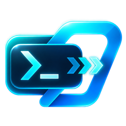

<p align="center"></p>
<h1 align="center">Command Relay</h1>
<p align="center">A local-first Windows workbench for human-controlled AI-assisted development.</p>
<p align="center">
  <a href="https://github.com/DEViANCEVxXXxM/command-relay/actions/workflows/ci.yml"></a>
  <a href="https://github.com/DEViANCEVxXXxM/command-relay/actions/workflows/codeql.yml"></a>
  <a href="https://github.com/DEViANCEVxXXxM/command-relay/releases"></a>
  <a href="LICENSE"></a>
</p>
<p align="center"><a href="https://deviancevxxxxm.github.io/command-relay/">Documentation</a> &middot; <a href="https://github.com/DEViANCEVxXXxM/command-relay/releases">Releases</a> &middot; <a href="CHANGELOG.md">Changelog</a> · <a href="docs/COMMAND_RELAY_AI_GUIDE.md">AI operating guide</a> · <a href="docs/manual.txt">Full manual</a> · <a href="SECURITY.md">Security</a></p>

> [!WARNING]
> **Run code at your own risk.** Command Relay is not a sandbox. The maintainers and contributors do not guarantee or accept responsibility for AI-generated or other third-party scripts, executables or code run through the application, to the extent permitted by law. Read the [full disclaimer and acknowledgement](DISCLAIMER.md) before use.

## What it does

Command Relay bridges an AI chat and a local development workspace without granting the AI direct access to your computer. Import a structured task or PowerShell script, review the exact commands and workspace, explicitly run them, and copy a structured result back to the chat.

**Import → Review → Run → Copy**

- Qt Workbench: script editor, live terminal, step outline, script library and history.
- Task, result and session JSON packets for structured collaboration and handoff.
- Evidence extraction, declared assertions, comparisons and read-only Git dashboard tools.
- Local report archives and evidence ZIP exports; best-effort secret masking in protected exports.
- No mandatory API key, account, telemetry or cloud connection. Commands may access the network if you explicitly run such commands.

## 4.4.0 — Unified Experience Update

This section describes version 4.4.0. Consult Releases for published, signed packages.

- One full-width workbench with top navigation, a resizable command editor and terminal, and optional bottom utilities. Ordinary manual Run needs no second confirmation; high-risk and failed/uncertain repeat review remains.
- Reviewed dependency-aware task batches: explicit workspaces, sequential by default, opt-in bounded parallel workers for independent tasks. No sandbox or unattended arbitrary PowerShell.
- Personal Skills, bounded read-only metadata plans, runtime diagnostics, recent reports and structured session handoff.
- Optional off-record AI Chat (Qt WebEngine), reviewed same-origin JSON import and masked draft insertion into a supported empty textarea. No automatic Send, provider API requirement or guaranteed provider compatibility.
- Smart masked JSON, Detailed masked JSON, protected text and unmasked RAW export. Plain click = Smart; Shift+click = protected text; Ctrl+click = RAW (Ctrl wins). Review exports before sharing.
- 17 selectable interface languages: English/Russian and 15 translation previews; Arabic RTL chrome, LTR commands, paths and reports. Preview translations are not independently certified.

Automated Grand QA: 479 tests on Windows and Linux; 17 locale layouts at synthetic 100%, 150% and 200% scaling, native font samples, disposable batch execution and loopback browser. Real native visual/DPI, provider login, independent translation/legal review and production signed update acceptance remain separate.

## What's new in 4.3.0 — Automatic Updates

- **More → Settings → Updates…**: explicitly check stable GitHub releases, download and verify a newer signed package, and prepare an update. No automatic polling or unattended install.
- Publisher authentication uses Ed25519, a pinned public key and a signed manifest binding the archive and every program file. Installation requires a separate application-local opt-in and terminal confirmation.
- A separate updater holds a cooperative lock, writes backups and transaction intent, replaces approved files, and preserves recovery evidence. Pending recovery blocks supported normal launchers. A successful commit can offer a separately confirmed restart.
- **First signed version:** manually extract into a new folder; do not update unsigned 4.2.0 in place. Keep all four original signed assets together outside the application folder for future updates. Copy only backed-up user data, not grants. The updater requires an unchanged supported layout and dependencies, a trusted external Python runtime and a writable parent directory. Unexpected files (including existing caches), source checkouts and modified program files are denied.
- Independent-process update/recovery and extracted GUI startup have been tested separately. A real production signed-to-signed GUI update has not yet been demonstrated. See the [manual](docs/manual.txt) and [security policy](SECURITY.md).

## Safety & Control Center — introduced in 4.2.0

- Built-in automatic squash merge requires an explicit, scoped opt-in in **More → Settings → Safety settings…**, plus review of the specific task. It is off by default.
- Review the resolved workspace and repository, revoke grants, or inspect up to 128 local permission changes in History. Authorization is rechecked before a merge request.
- Settings group existing safety and display preferences. Action rows adapt to longer labels and compact windows, including RTL.
- Other unattended actions are not implemented. The policy does not control arbitrary reviewed scripts, and is not a sandbox. Expanded localization and reviewed batch execution were not part of 4.2.0.

## Workflow Intelligence — introduced in 4.1.0

- Review matching previous runs before repeating a task.
- Inspect more indirect Git and process operations with heuristic warnings.
- Use the optional GitHub PR manager (`More → Git → GitHub pull requests…`) with authenticated `gh` to inspect CI and explicitly confirm squash merges.
- Run reviewed tasks that wait for CI and, with the scoped opt-in, merge the specified PR; exact commit checks and GitHub protection still apply. There is no automatic execution on import.
- Preview actionable session context and choose masked or raw report export modes explicitly.

GitHub integration is optional and can perform remote writes only when requested. Review commands and permissions before execution; neither the inspector nor secret masking is a security boundary. Expanded localization and parallel execution were not part of 4.1.0.

## Quick start

1. Download the portable Windows ZIP from [Releases](https://github.com/DEViANCEVxXXxM/command-relay/releases), or clone the repository if a release is not yet available.
2. Extract into a new writable folder. Install Python 3.10–3.14 (64-bit recommended), PowerShell and optionally Git for Git features.
3. In that folder, install the required dependencies:

   ```powershell
   python -m pip install -r requirements.txt
   ```

4. Open `Start.pyw` (or `Start.cmd`); use `tools/Start-Debug.cmd` if startup fails. Read the startup disclaimer and explicitly agree to continue. Declining or closing the dialog exits without opening the workbench.
5. Choose your workspace, import [`examples/example-ai-task.json`](examples/example-ai-task.json), review it, click **Run commands**, then **Copy**. The fictional smoke task should report PASS.

The portable ZIP includes Python source and launchers, not Python itself or a compiled executable. Windows is the supported application target; Linux CI covers platform-independent logic only. CI tests Python 3.10, 3.12, 3.13 and 3.14 on Windows and Linux, with Windows Qt smoke checks on Python 3.12 and 3.14. Python 3.11 is not currently included in the CI matrix.

## How the workflow fits together

| Step | You control | Command Relay provides |
| --- | --- | --- |
| Import | Which task enters the editor | Structured JSON or a PowerShell script |
| Review | Workspace, commands and risks | Editable script and heuristic warnings |
| Run | When execution starts or stops | Local execution and live output |
| Copy | What evidence is shared | Structured results and best-effort protected exports |

## Work with an AI chat

Attach [the AI operating guide](docs/COMMAND_RELAY_AI_GUIDE.md) to your chat. Ask the assistant to produce `command-relay/task-v1` JSON, import it, review the commands, and send back `command-relay/result-v1` using Copy. In 4.4.0, use **Tools → Copy session context** (More in 4.3) to resume in another chat.

## Safety and privacy

Relay executes commands under your own account permissions. It is not a sandbox. Task Inspector is heuristic, not a complete security boundary. Protected exports mask recognizable secrets on a best-effort basis, not all sensitive information. Raw reports, raw Copy, evidence ZIPs and local scripts can expose credentials and private paths. Always review before running or sharing. Never commit local reports, settings or script libraries. See [SECURITY.md](SECURITY.md).

## Development

Use the full GitHub repository checkout for these commands; the portable runtime ZIP intentionally omits developer tooling.

```shell
python -m unittest discover -v
python tools/build_release.py
```

With PySide6 installed, run `python tools/smoke_qt.py` for GUI regressions with mocked dispatch. Optional `--native-batch --browser-bridge` adds disposable PowerShell and loopback browser checks. Routine checks do not save screenshots. See [CONTRIBUTING.md](CONTRIBUTING.md), [architecture](docs/architecture.md) and [maintainer setup](docs/github-setup.md).

## Compatibility

Version 4.4.0 builds on the package layout introduced in 4.0.3 (`command_relay/`, `docs/`, `examples/` and `tools/`). The `task-v1`, `result-v1` and `session-v1` schemas, example contents, startup acknowledgement and local data locations are unchanged. The root `Start.pyw` and `Start.cmd` launchers remain; diagnostic launch is now `tools/Start-Debug.cmd` (or `python -m command_relay` from the distribution root). Extract new releases into a new folder; do not overlay old versions. Move old `reports/`, `scripts/` and `settings.json` only after making a backup, as described in the [manual](docs/manual.txt). Do not copy automation grants into a new installation; review and explicitly enable a new grant if desired. Keep `automation-permissions.json` private.

## License

Command Relay is distributed under the [Apache License 2.0](LICENSE). See [NOTICE](NOTICE) for attribution. The license permits commercial use, modification and distribution, including proprietary derivatives, subject to its terms. Preserve applicable notices, supply the license and identify modified files when distributing derivative works. Third-party dependencies are separately licensed; see their upstream terms. The portable archive does not bundle Python, PowerShell, PySide6 or cryptography.

The [disclaimer](DISCLAIMER.md) describes execution risks and is not an amendment to the license.

## Attribution

If you use this project, parts of it, or draw on it as a reference or inspiration, please credit Command Relay and link to the original GitHub repository. Attribution for inspiration alone is a request, not an additional license requirement.


### Personal Skills

Use **Skills** to import reusable AI instructions and optional task templates into the per-user data directory. Personal skills are not part of the signed program files, do not auto-run or grant permissions, and are kept across supported updates. Use a source checkout or independent fork for changes to Command Relay itself; do not patch the managed installation for personal workflows. See the [AI guide](docs/COMMAND_RELAY_AI_GUIDE.md) and [architecture](docs/architecture.md).
